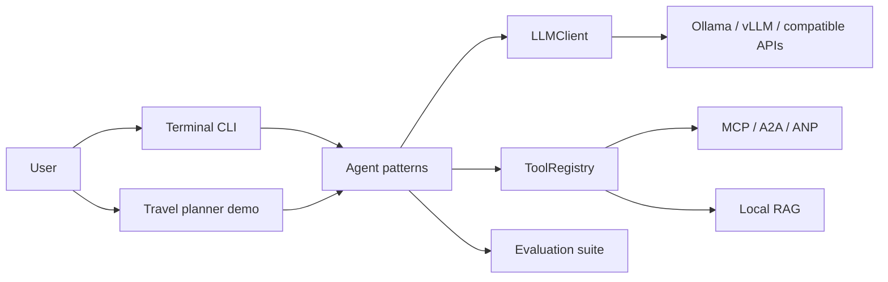

# MyAgents CSY

MyAgents CSY is a lightweight Python agent framework with a terminal interface and an OpenAI-compatible model backend. It separates agent behavior, model access, tools, context management, and evaluation so each component can be developed and tested independently.

## Capabilities

- **Agent patterns:** Simple, ReAct, Reflection, and Plan-and-Solve, plus document and codebase assistants.
- **Model portability:** Ollama, vLLM, and other OpenAI-compatible services through one `LLMClient` interface.
- **Tool use:** Registry-based tools, native function calling with a text fallback, and optional MCP, A2A, and ANP adapters.
- **Grounded workflows:** Local document RAG, context budgeting, and conversation summarization.
- **Experiments:** Isolated training and evaluation modules for tool use, answer quality, and multi-step trajectories.
- **Application example:** A local travel planner using Ollama and validated mock data, with an editable itinerary and budget view.

The travel planner is a **single-agent demonstration**. Its attractions, weather, prices, and map coordinates are illustrative; it does not call live travel APIs.

## Architecture



## Quick start

Requires Python 3.10+. The default local setup uses [Ollama](https://ollama.com/) with `qwen2.5:7b`.

```bash
python -m venv .venv
source .venv/bin/activate
python -m pip install -e '.[dev]'
ollama pull qwen2.5:7b
# Start Ollama if it is not already running: ollama serve
python -m my_agents --agent react
```

To configure another provider, copy `.env.example` to `.env` and set `LLM_MODEL_ID`, `LLM_API_KEY`, and `LLM_BASE_URL`. The real `.env` is ignored by Git.

### Local travel planner

```bash
python -m examples.travel_demo.server
```

Open <http://127.0.0.1:8765>. The demo supports three cities and one to three days, preference and budget inputs, itinerary editing, browser-local drafts, and JSON/PDF export. It uses local mock tools and a fixed Ollama endpoint; no map, image, or paid model key is required. Implementation details are in [the travel demo design](./examples/travel_demo/DESIGN.md).

## Project layout

| Path | Purpose |
|---|---|
| `my_agents/core/`, `my_agents/agents/` | Shared contracts, model client, and agent patterns |
| `my_agents/tools/`, `my_agents/protocols/` | Tool registry and protocol adapters |
| `my_agents/rag/`, `my_agents/context/` | Retrieval and context management |
| `my_agents/rl/`, `my_agents/evaluation/` | Training experiments and evaluation |
| `examples/travel_demo/` | Local web application example |
| `tests/` | Automated tests using fake services where possible |

## Tests

```bash
python -m pytest tests/test_travel_demo.py -q
```

The full suite may require the optional dependency groups defined in `pyproject.toml`. Training runs and published benchmark results are not implied by the presence of the experiment modules.

## Acknowledgment

The learning path was inspired by [Datawhale Hello-Agents](https://github.com/datawhalechina/Hello-Agents). The framework implementation and local application in this repository are maintained separately.
